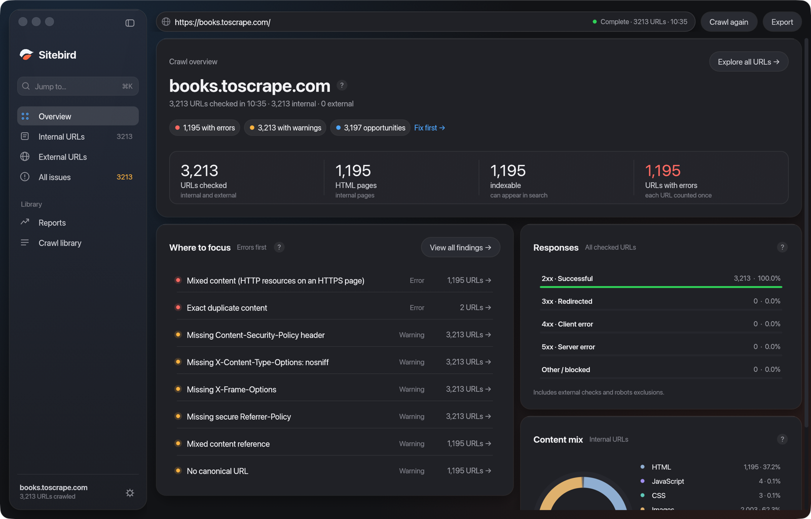
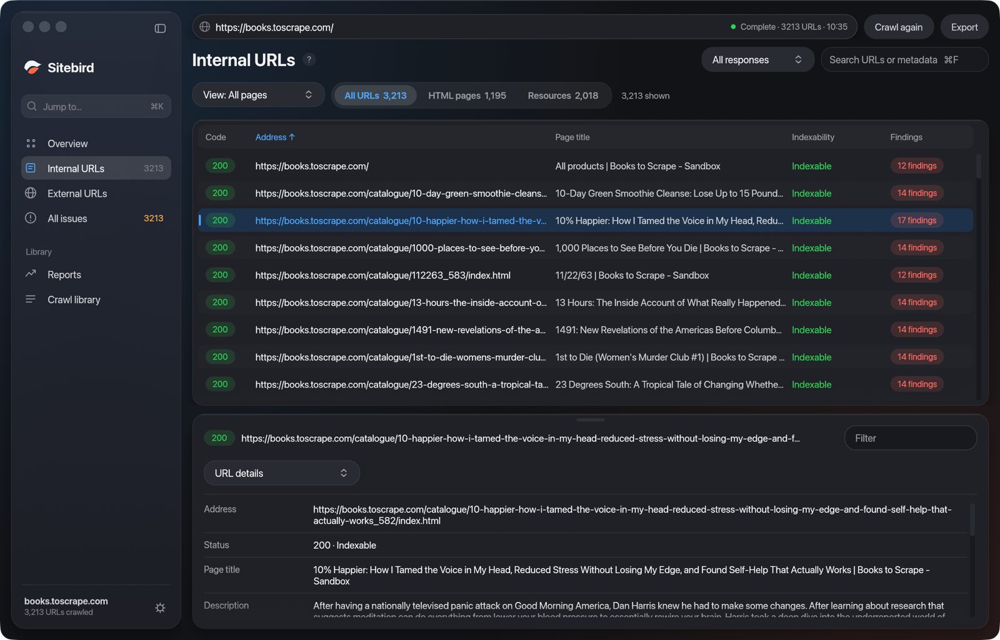
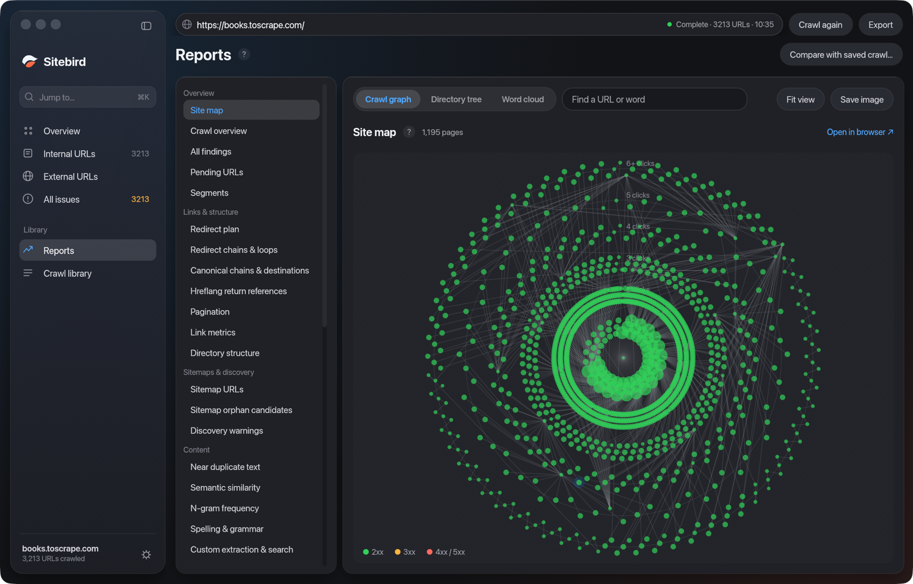
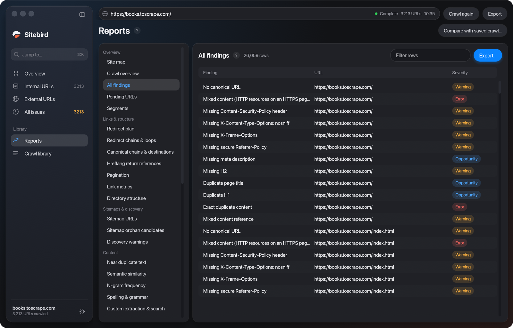
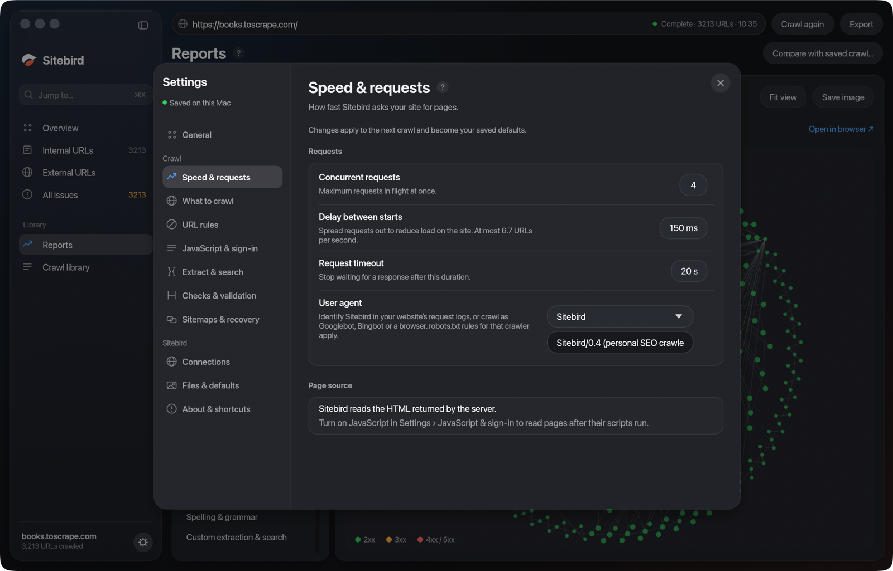
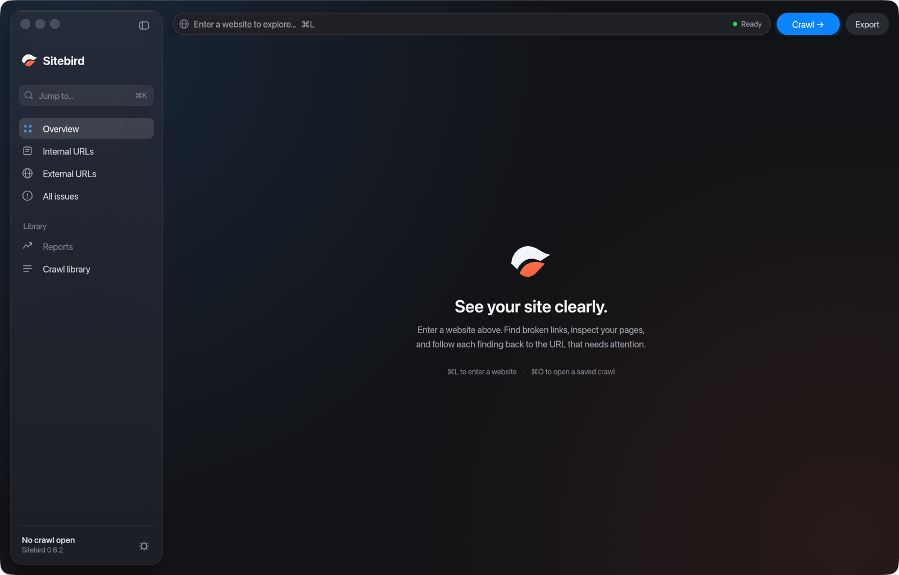

<p align="center"></p>

<h1 align="center">Sitebird</h1>

<p align="center"><strong>A fast SEO crawler for the Mac. No account, no licence key, no URL limit.</strong></p>

<p align="center"><a href="https://github.com/SamDeHerdt/Sitebird-releases/releases/latest"><strong>Download the latest version</strong></a></p>

Paste a website address, press **Crawl**, and Sitebird walks the whole site the way a search engine does. It finds broken links, redirects, missing or duplicate titles and descriptions, images without alt text, canonical and indexing problems, structured data errors and much more, and every finding takes you to the exact URLs that need attention.



## What it does

- **Crawl a site or a list of URLs.** Pause, resume or stop at any time and keep what was collected. You choose the speed (connections and delay), the scope and the limits; robots.txt is respected by default. Very large sites can be crawled to disk instead of memory.
- **Overview.** Content types, response codes and the findings that matter most, each one click away from the URLs behind it.
- **Inspect every page.** Response codes, page titles, meta descriptions, headings, images, canonicals, directives, content, structured data and hreflang, each as a sortable, searchable table. Click a URL to see its details, inlinks and outlinks.
- **Reports.** Redirect chains and loops, canonical chains, hreflang return links, security and mixed content, response headers and times, pagination, near-duplicate text, N-grams, PDF text, automated accessibility checks, custom extraction and search, sitemap orphans, link metrics and an interactive site map.
- **Compare two crawls** of the same site: what was added, removed or changed.
- **Plan redirects** for a site migration and export them as a CSV ready for HubSpot's bulk import.
- **Export** URLs, links, issues, every report and an XML sitemap. Save crawls and reopen them later from the crawl library.
- **Schedule crawls** to run by themselves.
- **Crawl behind a login** with browser authentication.
- **Connect your own accounts** (optional): Google Search Console, Google Analytics 4, PageSpeed Insights, Moz, Majestic, and AI providers (OpenAI, Anthropic, Gemini) for content checks.
- **Terminal and AI tools.** The app includes `sitebird-cli` for crawls and exports from Terminal, and a local MCP server so tools like Claude Code can run and query crawls.

<table>
<tr>
<td width="50%"><br><sub>Every URL, with the selected page's details, inlinks and outlinks below.</sub></td>
<td width="50%"><br><sub>The site map: crawl graph, directory tree and word cloud.</sub></td>
</tr>
<tr>
<td width="50%"><br><sub>Reports grouped by topic, each one exportable.</sub></td>
<td width="50%"><br><sub>You set the speed, scope and limits of every crawl.</sub></td>
</tr>
</table>

<sub>Screenshots: a crawl of books.toscrape.com, a public practice site for crawlers.</sub>

## Install

You need a Mac with **Apple silicon (M1 or newer)** and **macOS 14 or newer**.

1. Download `Sitebird-0.6.2.dmg` from [the latest release](https://github.com/SamDeHerdt/Sitebird-releases/releases/latest).
2. Open it and drag **Sitebird** into **Applications**.
3. Open Sitebird. The first time, macOS may say it can't check the app for malicious software, because Sitebird is not notarized by Apple. Click **Done**, then go to **System Settings → Privacy & Security**, scroll down and click **Open Anyway**. You only do this once. Only approve a copy you downloaded from this page.

The download's checksum is in `SHA256SUMS.txt` on the release page.

**Optional extras.** Everything above works on its own. Two features need extra software on your Mac:

- **JavaScript rendering and Lighthouse checks** need [Google Chrome](https://www.google.com/chrome/) and Node.js from [Homebrew](https://brew.sh) (`brew install node`).
- **Integrations** need your own account or API key for that service, entered under **Crawl → Connections → Connection Settings**.

## Use it



1. Type or paste a website address at the top and press **Crawl**.
2. Watch the **Overview** fill in. Click any chart segment or finding to see the URLs behind it.
3. Use **Internal URLs**, **All issues** or the **Inspect** views to dig in, and click a row for that page's details.
4. **Export** what you need, or save the crawl (⌘S) to reopen it later.

Settings (⌘,) apply to the next crawl. **⌘K** jumps to any view, report or URL.

From Terminal:

```sh
/Applications/Sitebird.app/Contents/MacOS/sitebird-cli crawl https://example.com/ --session crawl.sitebird.json --csv urls.csv
/Applications/Sitebird.app/Contents/MacOS/sitebird-cli --help
```

## What it can't do yet

- **Mac only**, Apple silicon only. There is no Windows or Linux version.
- **Not notarized by Apple**, so the first launch needs the Open Anyway step above.
- **No automatic updates.** Check this page for new versions and install them the same way.
- **Some checks need extra software** (Chrome and Node.js, see Install). Advanced spelling and grammar (LanguageTool) and full structured-data validation need extra runtimes that are not included in the download; the built-in macOS spelling check works without them.
- **Results are signals, not verdicts.** Indexability is a check of the page's own signals, not Google's decision, and structured data is checked against public Schema.org rules, not every rule Google applies.
- **Early software.** Some reports are partial and say so on screen. Very large crawls in memory can run out of RAM; use disk crawling for those.

## Privacy

Sitebird runs on your Mac. There is no account and no telemetry. It only contacts the websites you crawl and the services you connect yourself, and your crawls stay on your Mac.

---

This repository holds the downloads only; the source code is private. Report problems under [Issues](https://github.com/SamDeHerdt/Sitebird-releases/issues), without private site data or API keys.

© 2026 Sam De Herdt. Third-party licences are included in the app (`Sitebird.app/Contents/Resources/Licenses`).
